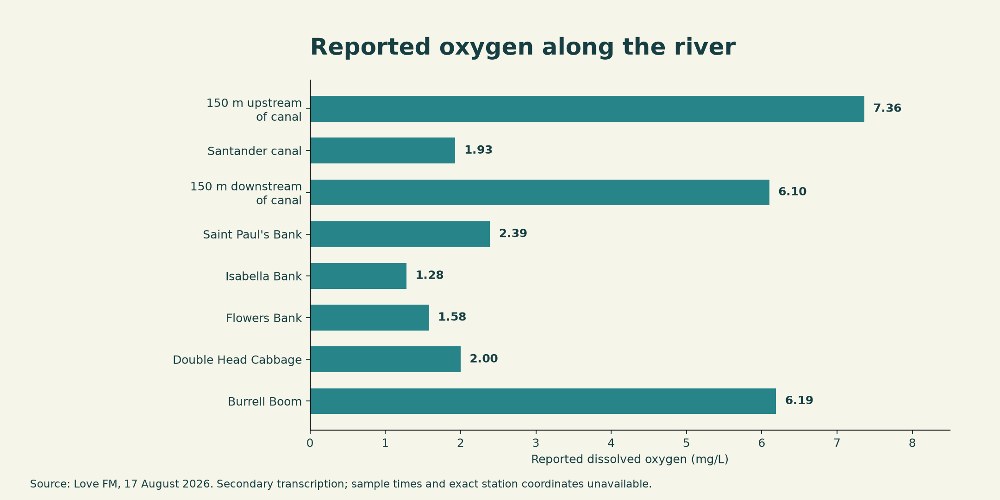
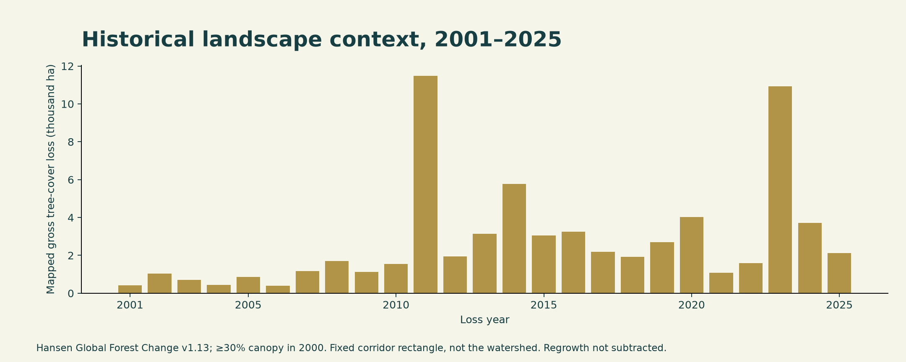

# Following the Water
### Mapping the evidence behind the Belize River fish kill

**Python · GIS · environmental evidence · ArcGIS StoryMaps**

Growing up in Belize City, I often visited my family's property in Bermudian Landing. The Belize River and the villages around it became familiar places long before I began studying marine biology. Reports of fish dying in the river brought me back to the valley with a different question: **what could the available evidence tell us about the event, and where were the gaps?**

This project brings reported dissolved-oxygen readings together with community locations, rainfall estimates and historical tree-cover loss. I developed it during the National Geographic Society and The Nature Conservancy conservation externship through Extern. This repository preserves a selected, documented part of the GIS workflow and adds a portable Python version that runs without ArcGIS Pro.

**[Read the published StoryMap](https://storymaps.arcgis.com/stories/e6ee90cbb7d04636bd0248661512deea)** · **[Explore the ArcGIS oxygen map](https://www.arcgis.com/apps/mapviewer/index.html?webmap=dba520eb2a4c457baa6beb8ddd0e6632)** · **[Open the portable map](https://kylealibz.github.io/following-the-water/evidence_explorer.html)**



## What the maps do

| Question | GIS approach | Important limit |
|---|---|---|
| Where were low oxygen values reported? | Join five readings to GeoNames settlement references and use proportional circle areas | Community points are not sampling stations |
| What information is missing? | Preserve four missing community values and three unlocated canal-relative readings | Missing does not mean zero or no monitoring |
| What rainfall preceded the reports? | Display five equal seven-day CHIRPS rainfall windows | Rainfall estimates do not measure runoff or identify contaminants |
| How had the surrounding landscape changed? | Summarize Hansen annual tree-cover loss within a fixed corridor rectangle | Gross tree-cover loss is not net forest change or proof of a cause |
| How well do reference datasets align? | Project points and river centerlines to UTM 16N and calculate nearest distance | Dataset offsets do not measure exposure or river travel |

The published project also includes watershed context, approximate canal-reference annotations, satellite comparisons and a village tour. Those elements remain in the StoryMap; this repository is a focused evidence and methods companion, not a complete offline copy of every story block.

## Read the results carefully

The five community-associated readings range from **1.28 to 6.19 mg/L**. All eight values come from a reported briefing, not field measurements collected by this project. Original sample times, instrument details and station coordinates were unavailable. Publication dates are retained separately from sampling dates.

The project helps readers examine spatial context and the limits of the evidence. It does not establish a single responsible agricultural operation, reconstruct a chemical plume, or diagnose deaths from satellite colour. The rainfall and tree-cover layers add context; their overlap with the river is not a causal test.



*Hansen Global Forest Change v1.13. The summary uses places with at least 30% tree canopy in 2000, within the rectangle 88.90°W–88.30°W and 17.25°N–17.75°N. This is not the entire Belize River watershed. Estimates are approximate hectares; regrowth is not subtracted, and 2026 is not included.*

## Run it without ArcGIS Pro

Requires Python 3.10 or later. From the repository root:

```bash
python -m venv .venv
# Windows PowerShell:
.venv\Scripts\Activate.ps1
# macOS / Linux:
# source .venv/bin/activate

python -m pip install -r requirements.txt
python scripts/build_evidence.py
python scripts/render_portfolio.py
python -m unittest discover -s tests
```

Open `docs/evidence_explorer.html` in a browser. Click circles to inspect the source and location caveats. The collapsed layer menu contains five rainfall windows; select **one rainfall week at a time**. Internet access is needed for Leaflet assets and OpenStreetMap tiles. No ArcGIS login or API key is required.

`build_evidence.py` also runs with the Python standard library alone. It writes a GeoJSON join, an eight-row CSV and validation counts. The checks protect the distinction between measured values, missing records and unknown locations, and verify that symbol area is proportional to value.

### Optional reference-distance analysis

```bash
python scripts/collect_public_mapping.py --out data/external
python scripts/reference_offsets.py
```

The collector is retained from the original project. It downloads public river features, GeoNames references and paginated Sentinel-2 scene metadata. It does not download imagery pixels or classify water quality. Downloads may change as providers update their services. River data are retrieved on demand because a redistribution licence was not established in the saved project metadata.

The distance script transforms WGS84 longitude/latitude into **WGS84 / UTM zone 16N (EPSG:32616)**. It calculates shortest planar distance from each settlement reference to the mapped Belize River centerline. These are dataset-alignment checks, not risk scores.

### ArcGIS files and optional ArcPy export

The original `.aprx`, `.ppkx`, file geodatabase and PDF atlas were recovered locally. They have been preserved on the author's computer. They are not included in this public repository because the project archive contains older revisions, local dependencies and media with separate reuse conditions. Their filenames and SHA-256 hashes are recorded in [the archive inventory](docs/local_archive_inventory.json).

If ArcGIS Pro becomes available again, `arcgis/create_geodatabase.py` can import the portable community data into a new file geodatabase. It requires a licensed ArcPy environment. It has been syntax-checked here, but has not been executed as part of this portable release.

## Repository guide

```text
scripts/     public-data collector, evidence join, figures, HTML map, distance analysis
archive/     original GDAL tree-loss processing script and its input requirements
data/        source-linked reported values, GeoNames points and saved context summaries
results/     generated GeoJSON, CSV and evidence validation
figures/     reproducible data graphics used in this README
docs/        interactive map, methods, data credits and local archive inventory
arcgis/      optional ArcPy import adapter
tests/       evidence and proportional-symbol checks
```

See [methods and reproducibility](docs/methods.md) and [data sources and reuse](docs/data_sources.md). The saved rainfall and forest summaries are inputs to this release; running the portable scripts does **not** regenerate them from the global source rasters.

## Author

**Kyle Ali** · Marine biology student, University of Belize · [Portfolio](https://kylealibz.github.io/)

The project reflects my connection to the Belize River Valley and my interest in freshwater and marine conservation. Source limitations remain part of the results.

The project was developed through the externship; this repository is a personal portfolio presentation and does not imply institutional endorsement. Original repository code is MIT licensed. Third-party data retain their own terms; see the source notes. News photographs, interview portraits and other unverified third-party media have not been copied into this repository.
